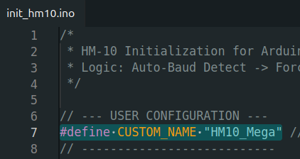
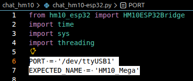
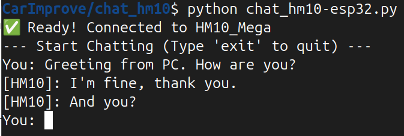

# CarCarImprove Wireless

Send text between your PC and an Arduino over Bluetooth Low Energy, using an HM-10 module on the Arduino. This replaces the HC-05 modules used on earlier CarCar cars.

The PC can reach the HM-10 in two ways:

| Path | You need | Used for |
|------|----------|----------|
| **ESP32 bridge** | An ESP32 board flashed with the `esp32-hm10` firmware. It plugs in over USB and does the Bluetooth part, so it works the same on every PC. | The chat demo, and the Python API for your own programs |
| **Direct BLE** | A PC with Bluetooth 4.0 or newer | The chat demo only |

```
PC (Python) ── USB ── ESP32 ── BLE ── HM-10 ── Arduino Mega      ESP32 bridge
PC (Python) ───────── BLE ─────────── HM-10 ── Arduino Mega      Direct BLE
```

This guide has two parts:

- [Part 1: Chat demo](#part-1-chat-demo) sets up the HM-10 and runs a chat program, to check that everything works.
- [Part 2: Using it in your own program](#part-2-using-it-in-your-own-program) shows the Python API for sending and receiving messages.

## What you need

- Arduino Mega and an HM-10 module
- An ESP32 development board with the `esp32-hm10` firmware (ESP32 bridge path)
- USB cables
- [Arduino IDE](https://www.arduino.cc/en/software)
- Python 3.12

## Part 1: Chat demo

### Step 1: Get the code and install the Python packages

```bash
git clone https://github.com/ANCuber/CarCarImproveWireless.git
cd CarCarImproveWireless
pip install pyserial bleak
```

`pyserial` is for the ESP32 bridge path and `bleak` is for the direct BLE path. If you use conda, `conda env create -f environment.yml` followed by `conda activate carcar` installs both.

### Step 2: Set up the HM-10

1. Wire the HM-10 to the Arduino Mega:

   | HM-10 pin | Arduino Mega pin |
   |-----------|------------------|
   | VCC       | 5V               |
   | GND       | GND              |
   | TX        | RX3 (pin 15)     |
   | RX        | TX3 (pin 14)     |

   This wiring is for the course's HM-10 board (the module sits on a black 6-pin base board). A bare HM-10 module needs 3.3 V on VCC and a voltage divider between the Mega's TX3 and the module's RX. If you buy your own boards, see [Buying HM-10 boards](#buying-hm-10-boards).

2. Open [init_hm10/init_hm10.ino](init_hm10/init_hm10.ino) in Arduino IDE and change `CUSTOM_NAME` to a name of your own (at most 12 characters). Pick a name nobody else in the room uses.

   

3. Upload the sketch to the Mega, then open the Serial Monitor at **115200 baud**. The sketch finds the HM-10, resets it to factory settings, and sets the name. It ends with `Initialization Complete.`

   

Leave this sketch on the Mega and keep the Serial Monitor open. After the setup it passes everything between the Serial Monitor and the HM-10, which you use to test the chat in the next step.

### Step 3 (ESP32 bridge): Chat through the ESP32

This needs an ESP32 that already has the `esp32-hm10` firmware. The one you were given is flashed already.

1. Plug the ESP32 into your PC and find its serial port:
   - **Windows**: Device Manager → "Ports (COM & LPT)" (連接埠), for example `COM3`
   - **Linux**: `ls /dev/ttyUSB*`, for example `/dev/ttyUSB0`
   - **macOS**: `ls /dev/cu.usbserial*`, for example `/dev/cu.usbserial-0001`

   If no port shows up, install the CH340 USB driver. See the [CH340 driver installation guide](https://docs.google.com/presentation/u/0/d/1AppyLZE2i848UmYqMS-MMrL8-V6ORkutv9SstkJ2Zmo).

2. In [chat_hm10/chat_hm10-esp32.py](chat_hm10/chat_hm10-esp32.py), set `PORT` to that serial port and `EXPECTED_NAME` to the HM-10 name from Step 2.

   

3. Run the script from the `chat_hm10` folder:

   ```bash
   cd chat_hm10
   python chat_hm10-esp32.py
   ```

   The script tells the ESP32 which HM-10 to look for and restarts the ESP32 if the name changed. It then checks the link once per second and prints `Ready! Connected to <name>` once the link is up. Press Ctrl+C to stop waiting.

4. Type a message and press Enter. It appears in the Arduino Serial Monitor. Text sent from the Serial Monitor appears in the terminal. Type `exit` to quit.

   
   

### Step 3 (Direct BLE): Chat without an ESP32

1. Turn on Bluetooth on your PC. If an ESP32 bridge is powered nearby and set to your HM-10, unplug it: the HM-10 accepts one connection at a time.
2. In [chat_hm10/chat_hm10-bleak.py](chat_hm10/chat_hm10-bleak.py), change `target_name="HM10_Mega"` in `main()` to the HM-10 name from Step 2.
3. Run the script from the `chat_hm10` folder:

   ```bash
   cd chat_hm10
   python chat_hm10-bleak.py
   ```

   It prints `Connected to <name>` when the link is up. Chat the same way as above.

Direct BLE is here as a demo only. The API in Part 2 uses the ESP32 bridge.

## Part 2: Using it in your own program

The chat script in Part 1 is for trying things out and for debugging. To exchange messages with the Arduino from your own Python program, use the `hm10_esp32` module. It talks through the ESP32 bridge and works like a serial port: open, connect, then `write()` and `read()`.

Before you start, set up the HM-10 as in Part 1, Step 2.

### Add the module to your project

1. Copy the folder [chat_hm10/hm10_esp32](chat_hm10/hm10_esp32) into your own project, next to the script that will use it:

   ```
   your_project/
   ├── hm10_esp32/        <- copied from this repository
   └── your_script.py
   ```

2. Install its one dependency:

   ```bash
   pip install pyserial
   ```

3. Import it in your script:

   ```python
   from hm10_esp32 import HM10ESP32Bridge
   ```

### The calls

| Call | What it does |
|------|--------------|
| `hm10 = HM10ESP32Bridge(port)` | Opens the ESP32's serial port, for example `'COM3'`. |
| `hm10.connect(name, timeout=-1)` | Tells the ESP32 which HM-10 to use and waits until the link is ready. Returns `True` once connected, `False` if `timeout` seconds pass first. With `timeout=-1` it waits until connected. Raises `ConnectionError` if no ESP32 answers on the port. |
| `hm10.write(data)` | Sends text (or bytes) to the Arduino. Returns the number of bytes sent. |
| `hm10.read(size=-1, timeout=0)` | Returns the text received so far, at most `size` characters. Returns `""` if nothing has arrived. With a `timeout`, it waits up to that many seconds for something to arrive. |
| `hm10.readline(timeout=-1)` | Waits for a full line and returns it, including the `\n` at its end. Returns `""` if `timeout` seconds pass first. |
| `hm10.is_connected()` | `True` while the link to the HM-10 is ready. |
| `hm10.close()` | Closes the serial port. |

The values shown after `=` are the defaults, used when you leave the argument out. As with `size`, `-1` for `timeout` means "no limit":

| Value | Meaning |
|-------|---------|
| `size=-1` | No limit: return everything received so far. A positive number, such as `size=5`, returns at most that many characters and keeps the rest for the next call. |
| `timeout=0` | Do not wait: return at once, with `""` if nothing is there. |
| `timeout=-1` | Wait with no time limit, until the data arrives (for `connect()`: until connected). Stop it with Ctrl+C. |

Any other `timeout`, such as `timeout=3`, waits at most that many seconds.

### Example

The Arduino adds 1 to every number it receives. Upload this sketch to the Mega (the HM-10 stays wired as in Part 1, Step 2):

```cpp
void setup() {
  Serial3.begin(9600);            // the HM-10 is on Serial3 at 9600 baud
}

void loop() {
  if (Serial3.available()) {
    String line = Serial3.readStringUntil('\n');
    line.replace("OK+CONN", "");  // the HM-10 prints these itself when
    line.replace("OK+LOST", "");  // a PC connects or disconnects
    line.trim();
    if (line.length() == 0) return;
    Serial3.println(line.toInt() + 1);
  }
}
```

The Python program sends numbers and reads the answers:

```python
from hm10_esp32 import HM10ESP32Bridge

hm10 = HM10ESP32Bridge('COM3')            # your ESP32's serial port
if not hm10.connect('HM10_Mega', timeout=30):
    print("Could not connect")
    hm10.close()
    exit()

for n in [1, 10, 100]:
    hm10.write(f"{n}\n")                  # end each message with \n
    answer = hm10.readline(timeout=3)     # "" if no answer within 3 seconds
    print(n, "->", answer.strip())

hm10.close()
```

Expected output:

```
1 -> 2
10 -> 11
100 -> 101
```

### Things to know

- **Mark the end of each message.** BLE delivers a long message in pieces of up to 20 bytes, so one `read()` can return half a message. End every message with `\n` and use `readline()` on the PC and `readStringUntil('\n')` on the Arduino, as in the example.
- **Polling instead of waiting.** In a loop that also does other work, call `hm10.read()` with no timeout. It returns at once, with `""` when nothing has arrived.
- **Text only, at a low rate.** The link carries UTF-8 text at roughly 250 bytes per second. Keep messages short.
- **`OK+CONN` and `OK+LOST` on the Arduino.** After `init_hm10`, the HM-10 prints these to `Serial3` when a PC connects or disconnects, with no `\n` after them. They can end up in front of your first message, so remove them as the example does. You can also use them to know when a PC is there.
- **Messages starting with `OK+`** sent from the Arduino are treated as replies from the ESP32 and do not reach `read()`. Do not start your own messages with `OK+`.

The full list of calls is in [chat_hm10/hm10_esp32/README.md](chat_hm10/hm10_esp32/README.md).

## Troubleshooting

| Problem | What to do |
|---------|------------|
| `init_hm10` prints `Failed to detect HM-10` | Check the wiring: TX goes to RX3 and RX goes to TX3. Check that VCC suits your board (5 V for the course's board, 3.3 V for a bare module). |
| The chat script keeps printing `ESP32 is DISCONNECTED` and never gets to `Ready!` | The ESP32 has not found the HM-10. A connection normally takes a few seconds. Check that the HM-10 is powered, that `EXPECTED_NAME` matches the name from Part 1, Step 2 exactly, and that nothing else (a phone, another PC) is connected to the HM-10. The script connects by itself once the HM-10 is found. |
| The chat script prints `No reply from the ESP32`, or `Target mismatch. Current: None` | The script is not talking to an ESP32 with this firmware. Check `PORT`, and check that the ESP32 is flashed. |
| `connect()` raises `ConnectionError: No reply from the ESP32` | Same cause: wrong serial port, or the ESP32 is not flashed. |
| `connect()` returns `False`, or never returns | The ESP32 answers but has not found the HM-10. Check the same things as for `ESP32 is DISCONNECTED` above. |
| `readline()` returns `""` | No complete line arrived in time. Check that the Arduino ends its messages with `\n` (`println`). |
| `idf.py: command not found` when flashing | The ESP-IDF environment is not loaded in this terminal. See [Appendix: Flashing the ESP32](#appendix-flashing-the-esp32), part 2. |
| The serial port cannot be opened ("Access is denied", "Resource busy") | Another program has the port open. Close other serial monitors and other copies of the script. |
| `chat_hm10-bleak.py` prints `Device not found` | Check that Bluetooth is on, the name matches, and the HM-10 is not already connected to an ESP32 or a phone. |
| Messages do not arrive in the Serial Monitor | Set the Serial Monitor to 115200 baud and keep the `init_hm10` sketch on the Mega. |

To check whether the HM-10 is advertising at all, scan for it with the nRF Connect app on a phone.

## Buying HM-10 boards

Check that the board has level shifters on TX and RX. Listings often say only "with base board", and many base boards have a voltage regulator but no level shifter. Ask the seller, or test one board when it arrives: put 5 V on VCC and leave the other pins open. If TX and RX read close to VCC (about 4.3 V on the course's board), the board has level shifters. If they read about 3.3 V, it has none, so add a voltage divider on the Mega's TX3.

## More documentation

- [chat_hm10/hm10_esp32/README.md](chat_hm10/hm10_esp32/README.md): full reference of the Python API
- [chat_hm10/hm10_bleak/README.md](chat_hm10/hm10_bleak/README.md): the module behind the direct BLE demo
- [esp32-hm10/README.md](esp32-hm10/README.md): ESP32 firmware, its AT commands and logs
- [esp32-hm10/IMPLEMENTATION_NOTES.md](esp32-hm10/IMPLEMENTATION_NOTES.md): how the firmware works inside
- [resource/DS-HM10.pdf](resource/DS-HM10.pdf): HM-10 datasheet with its AT command list

## Appendix: Flashing the ESP32

You do not need this if you were given an ESP32 that is already flashed. It is here for whoever prepares the boards, and for re-flashing after a firmware change.

### 1. Install ESP-IDF

Install ESP-IDF v6.1 with the ESP-IDF Installation Manager (`eim`). Version 5.3 and newer also work. The install downloads compilers and takes a while.

- **macOS**: follow the [macOS setup guide](https://docs.espressif.com/projects/esp-idf/en/stable/esp32/get-started/macos-setup.html). If `brew install` refuses to install `eim` because its tap is not trusted, run `brew trust` for that tap as the error message says, then run `brew install` again.
- **Windows**: follow the [Windows setup guide](https://docs.espressif.com/projects/esp-idf/en/stable/esp32/get-started/windows-setup.html). In short, open PowerShell and run:

  ```powershell
  winget install Espressif.EIM-CLI
  ```

  Close PowerShell, open it again, then run:

  ```powershell
  eim install
  ```

- **Linux**: A Linux user should figure things out themselves.

### 2. Load the ESP-IDF environment in your terminal

Installing ESP-IDF does not make `idf.py` available by itself. ESP-IDF keeps its own Python virtual environment and compilers, and you have to load them **in every new terminal** before using `idf.py`. If you skip this, you get `idf.py: command not found` (on Windows: `idf.py is not recognized`).

- **Windows**: run `eim shell`. It opens a shell with the environment loaded. Continue in that shell.

- **macOS**: find the activation script, then load it with `source`:

  ```bash
  ls ~/.espressif/tools/*.sh
  ```

  ```
  /Users/you/.espressif/tools/activate_idf_v6.1.sh
  /Users/you/.espressif/tools/deactivate_idf_v6.1.sh
  ```

  ```bash
  source ~/.espressif/tools/activate_idf_v6.1.sh
  ```

  Use the one whose name starts with `activate`. `eim shell` also works here. To avoid typing the path each time, add this line to `~/.zshrc`, then run `get_idf` in a new terminal whenever you need ESP-IDF:

  ```bash
  alias get_idf='source $HOME/.espressif/tools/activate_idf_v6.1.sh'
  ```

- **ESP-IDF installed without `eim`** (with `install.sh` or `install.bat`): the script is inside the ESP-IDF folder itself. Run `. <esp-idf folder>/export.sh` on macOS, `<esp-idf folder>\export.ps1` in PowerShell, or `<esp-idf folder>\export.bat` in Command Prompt.

If you do not know where ESP-IDF is installed, `eim list` prints the folder of each installed version.

Check that the environment is loaded:

```bash
idf.py --version
```

It prints `ESP-IDF v6.1`.

### 3. Build and flash

In the terminal where the environment is loaded, go to the firmware folder and build:

```bash
cd esp32-hm10
idf.py build
```

Plug in the ESP32 and flash it, with your ESP32's serial port in place of `PORT`:

```bash
idf.py -p PORT flash
```

Find the port as in Part 1, Step 3: for example `COM3` on Windows, `/dev/cu.usbserial-10` on macOS (`ls /dev/cu.*`), `/dev/ttyUSB0` on Linux.

You do not need to set the HM-10 name here. The chat script and `connect()` set it for you. More about the firmware and its AT commands is in [esp32-hm10/README.md](esp32-hm10/README.md).
