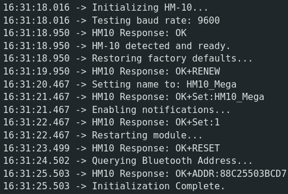
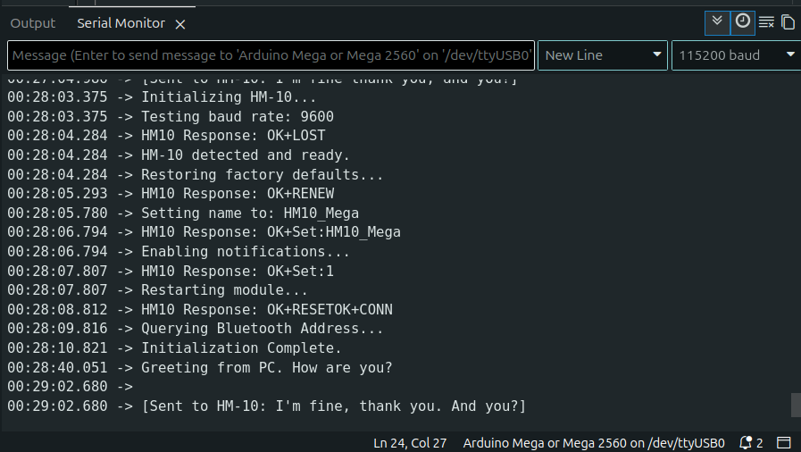

# CarCarImprove Wireless

Send text between your PC and an Arduino over Bluetooth Low Energy (BLE), using an HM-10 module on the Arduino.

```
PC (Python) ── USB ── ESP32 ── BLE ── HM-10 ── Arduino Mega      ESP32 bridge
PC (Python) ───────── BLE ─────────── HM-10 ── Arduino Mega      Direct BLE
```

- **ESP32 bridge**: an ESP32 on a USB port does the Bluetooth part, so it works the same on every PC. Use this for your own programs.
- **Direct BLE**: the PC's own Bluetooth talks to the HM-10. It is here as a demo only.

Contents:

- [Part 1: Chat demo](#part-1-chat-demo): set up the HM-10 and check that everything works.
- [Part 2: Using it in your own program](#part-2-using-it-in-your-own-program): the Python API.
- [Troubleshooting](#troubleshooting)
- [For developers](#for-developers): flashing the ESP32 and how the project works inside. You do not need it to use the system.

## What you need

- Arduino Mega and an HM-10 module
- An ESP32 board with the `esp32-hm10` firmware (the one you were given is flashed already)
- USB cables
- [Arduino IDE](https://www.arduino.cc/en/software)
- Python 3.12

## Part 1: Chat demo

### Step 1: Get the code

```bash
git clone https://github.com/ANCuber/CarCarImproveWireless.git
cd CarCarImproveWireless
pip install pyserial bleak
```

### Step 2: Set up the HM-10

1. Wire the HM-10 to the Arduino Mega:

   | HM-10 pin | Arduino Mega pin |
   |-----------|------------------|
   | VCC       | 5V               |
   | GND       | GND              |
   | TX        | RX3 (pin 15)     |
   | RX        | TX3 (pin 14)     |

   This wiring is for the course's HM-10 board. For any other HM-10 board, read [Buying HM-10 boards](#buying-hm-10-boards) first.

2. Open [init_hm10/init_hm10.ino](init_hm10/init_hm10.ino) in Arduino IDE. Change `CUSTOM_NAME` to a name nobody else in the room uses (at most 12 characters).

   

3. Upload the sketch and open the Serial Monitor at **115200 baud**. Wait for `Initialization Complete.`

   

Keep this sketch on the Mega and the Serial Monitor open. You chat through them in the next step.

### Step 3 (ESP32 bridge): Chat through the ESP32

1. Plug in the ESP32 and find its serial port:
   - **Windows**: Device Manager → "Ports (COM & LPT)" (連接埠), for example `COM3`
   - **macOS**: `ls /dev/cu.usbserial*`, for example `/dev/cu.usbserial-0001`
   - **Linux**: `ls /dev/ttyUSB*`, for example `/dev/ttyUSB0`

   No port? Install the [CH340 USB driver](https://docs.google.com/presentation/u/0/d/1AppyLZE2i848UmYqMS-MMrL8-V6ORkutv9SstkJ2Zmo).

2. In [chat_hm10/chat_hm10-esp32.py](chat_hm10/chat_hm10-esp32.py), set `PORT` to that port and `EXPECTED_NAME` to your HM-10 name.

   

3. Run it:

   ```bash
   cd chat_hm10
   python chat_hm10-esp32.py
   ```

   It keeps trying until it prints `Ready! Connected to <name>`. This normally takes a few seconds. Press Ctrl+C to give up.

4. Type a message and press Enter. It shows up in the Arduino Serial Monitor, and text sent from the Serial Monitor shows up in the terminal. Type `exit` to quit.

   
   

### Step 3 (Direct BLE): Chat without an ESP32

1. Turn on Bluetooth on your PC and unplug the ESP32. The HM-10 accepts one connection at a time.
2. In [chat_hm10/chat_hm10-bleak.py](chat_hm10/chat_hm10-bleak.py), change `target_name="HM10_Mega"` to your HM-10 name.
3. Run it, then chat as above:

   ```bash
   cd chat_hm10
   python chat_hm10-bleak.py
   ```

## Part 2: Using it in your own program

The `hm10_esp32` module lets your own Python program exchange text with the Arduino through the ESP32. It works like a serial port: connect, then `write()` and `read()`.

Set up the HM-10 first, as in [Part 1, Step 2](#step-2-set-up-the-hm-10).

### Add the module to your project

1. Copy the folder [chat_hm10/hm10_esp32](chat_hm10/hm10_esp32) next to your script:

   ```
   your_project/
   ├── hm10_esp32/        <- copied from this repository
   └── your_script.py
   ```

2. Install `pyserial`:

   ```bash
   pip install pyserial
   ```

### The calls

| Call | What it does |
|------|--------------|
| `hm10 = HM10ESP32Bridge(port)` | Opens the ESP32's serial port, for example `'COM3'`. |
| `hm10.connect(name, timeout=-1)` | Connects to the HM-10 called `name`. Returns `True` once connected, `False` on timeout. |
| `hm10.write(data)` | Sends text to the Arduino. |
| `hm10.read(size=-1, timeout=0)` | Returns the text received so far, at most `size` characters. Returns `""` if there is none. |
| `hm10.readline(timeout=-1)` | Waits for a full line and returns it with its `\n`. Returns `""` on timeout. |
| `hm10.is_connected()` | `True` while the link to the HM-10 is up. |
| `hm10.close()` | Closes the serial port. |

`timeout` is in seconds. `timeout=0` returns at once and `timeout=-1` waits with no limit. `size=-1` means everything. The values after `=` are the defaults.

### Example

The Arduino adds 1 to every number it receives. Upload this sketch to the Mega:

```cpp
void setup() {
  Serial3.begin(9600);            // the HM-10 is on Serial3 at 9600 baud
}

void loop() {
  if (Serial3.available()) {
    String line = Serial3.readStringUntil('\n');
    line.replace("OK+CONN", "");  // the HM-10 prints these itself when
    line.replace("OK+LOST", "");  // a PC connects or disconnects
    line.trim();
    if (line.length() == 0) return;
    Serial3.println(line.toInt() + 1);
  }
}
```

The Python program sends numbers and reads the answers:

```python
from hm10_esp32 import HM10ESP32Bridge

hm10 = HM10ESP32Bridge('COM3')            # your ESP32's serial port
if not hm10.connect('HM10_Mega', timeout=30):
    print("Could not connect")
    hm10.close()
    exit()

for n in [1, 10, 100]:
    hm10.write(f"{n}\n")                  # end each message with \n
    answer = hm10.readline(timeout=3)     # "" if no answer within 3 seconds
    print(n, "->", answer.strip())

hm10.close()
```

Expected output:

```
1 -> 2
10 -> 11
100 -> 101
```

### Things to know

- **End every message with `\n`**, and read with `readline()` on the PC and `readStringUntil('\n')` on the Arduino. A long message arrives in pieces, so a plain `read()` can return half of it.
- **To check for data without waiting**, call `hm10.read()`. It returns `""` when nothing has arrived.
- **Keep messages short.** The link carries text at about 250 bytes per second.
- **On the Arduino, remove `OK+CONN` and `OK+LOST`** as the example does. The HM-10 prints them when a PC connects or disconnects.
- **Do not start your own messages with `OK+`.** The module would take them for replies from the ESP32.

All calls are listed in [chat_hm10/hm10_esp32/README.md](chat_hm10/hm10_esp32/README.md). The reasons behind these rules are in [Limits of the link](#limits-of-the-link).

## Troubleshooting

| Problem | What to do |
|---------|------------|
| `init_hm10` prints `Failed to detect HM-10` | Check the wiring: TX goes to RX3 and RX goes to TX3. |
| The chat script prints `No reply from the ESP32`, or `connect()` raises `ConnectionError` | Wrong serial port, or the ESP32 is not flashed. |
| The chat script stays at `ESP32 is DISCONNECTED`, or `connect()` returns `False` or never returns | The ESP32 has not found the HM-10. Check that the HM-10 is powered, that the name matches exactly, and that no phone or other PC is connected to it. |
| `readline()` returns `""` | No full line arrived in time. Check that the Arduino ends its messages with `\n` (`println`). |
| The serial port cannot be opened ("Access is denied", "Resource busy") | Another program has the port open. Close other serial monitors and other copies of the script. |
| `chat_hm10-bleak.py` prints `Device not found` | Check that Bluetooth is on, the name matches, and the ESP32 is unplugged. |
| Messages do not arrive in the Serial Monitor | Set the Serial Monitor to 115200 baud and keep the `init_hm10` sketch on the Mega. |

To see whether the HM-10 is advertising at all, scan for it with the nRF Connect app on a phone.

## For developers

This section is for whoever prepares the hardware or changes the code. To use the system you do not need any of it.

### Repository layout

```
├── chat_hm10/
│   ├── chat_hm10-esp32.py     # chat demo, ESP32 bridge
│   ├── chat_hm10-bleak.py     # chat demo, direct BLE
│   ├── hm10_esp32/            # Python API for the ESP32 bridge (pyserial)
│   └── hm10_bleak/            # module behind the direct BLE demo (bleak)
├── esp32-hm10/                # ESP32 firmware (ESP-IDF, C)
├── init_hm10/                 # Arduino sketch that sets up an HM-10
└── resource/                  # screenshots for this README, HM-10 datasheet
```

### How the pieces talk

- **HM-10**: a BLE module with one service, `0xFFE0`, and one characteristic, `0xFFE1`. Bytes written to the characteristic come out of its UART to the Arduino (9600 baud). Bytes from the Arduino go out as BLE notifications of at most 20 bytes.
- **ESP32 firmware**: a BLE client. It scans for the HM-10 by name, connects, and reconnects by itself. It writes what it receives on its USB serial port (115200 baud) to the HM-10, at most 10 bytes at a time. It prints each notification as a log line tagged `bt_com`.
- **`hm10_esp32`**: reads the serial port and keeps only the `bt_com` lines. Lines starting with `OK+` are replies to the AT commands that configure the ESP32 (`AT+NAME`, `AT+STATUS?`, `AT+RESET`); the rest is data from the Arduino.
- **`hm10_bleak`**: the PC's own Bluetooth adapter takes the place of the ESP32. It writes to and gets notifications from `0xFFE1` directly.

Data, AT commands, replies and the ESP32's other logs all share one serial port. `hm10_esp32` therefore depends on the firmware's log format; change the two together.

The chat demo [chat_hm10-esp32.py](chat_hm10/chat_hm10-esp32.py) reads the HM-10 name stored in the ESP32. If it differs from `EXPECTED_NAME`, the script stores the new name and restarts the ESP32. It then asks for the link status once per second until the ESP32 reports that it is connected. `connect()` in `hm10_esp32` does the same.

### Limits of the link

- **Messages arrive in pieces.** The HM-10 sends what the Arduino writes as notifications of at most 20 bytes, and the ESP32 logs each one separately. One `read()` can therefore return part of a message. A `\n` at the end of each message, with `readline()`, puts the pieces back together.
- **About 250 bytes per second from the PC.** The firmware takes at most 10 bytes from its serial port per cycle, and a cycle takes 25 to 35 ms. This figure is calculated from those two numbers, not measured.
- **Text only.** `hm10_esp32` decodes what it receives as UTF-8 and drops bytes that are not valid UTF-8.
- **`OK+CONN` and `OK+LOST` on the Arduino.** `init_hm10` turns on the HM-10's connection notices (`AT+NOTI1`). The HM-10 then prints these strings to the Arduino when a PC connects or disconnects, with no `\n` after them, so they can end up in front of the first message. A sketch can also use them to know when a PC is there.
- **`OK+` is reserved.** The ESP32 answers AT commands on the same `bt_com` log lines that carry data. `hm10_esp32` treats every payload that starts with `OK+` as such an answer, so data from the Arduino that starts with `OK+` never reaches `read()`.

### Flashing the ESP32

#### 1. Install ESP-IDF

Install ESP-IDF v6.1 with the ESP-IDF Installation Manager (`eim`). Version 5.3 and newer also work. The install downloads compilers and takes a while.

- **macOS**: follow the [macOS setup guide](https://docs.espressif.com/projects/esp-idf/en/stable/esp32/get-started/macos-setup.html). If `brew install` refuses to install `eim` because its tap is not trusted, run `brew trust` for that tap as the error message says, then run `brew install` again.
- **Windows**: follow the [Windows setup guide](https://docs.espressif.com/projects/esp-idf/en/stable/esp32/get-started/windows-setup.html). In short, open PowerShell and run:

  ```powershell
  winget install Espressif.EIM-CLI
  ```

  Close PowerShell, open it again, then run:

  ```powershell
  eim install
  ```

- **Linux**: A Linux user should figure things out themselves.

#### 2. Load the ESP-IDF environment in your terminal

Installing ESP-IDF does not make `idf.py` available by itself. ESP-IDF keeps its own Python virtual environment and compilers, and you have to load them **in every new terminal** before using `idf.py`. If you skip this, you get `idf.py: command not found` (on Windows: `idf.py is not recognized`).

- **Windows**: run `eim shell`. It opens a shell with the environment loaded. Continue in that shell.

- **macOS**: find the activation script, then load it with `source`:

  ```bash
  ls ~/.espressif/tools/*.sh
  ```

  ```
  /Users/you/.espressif/tools/activate_idf_v6.1.sh
  /Users/you/.espressif/tools/deactivate_idf_v6.1.sh
  ```

  ```bash
  source ~/.espressif/tools/activate_idf_v6.1.sh
  ```

  Use the one whose name starts with `activate`. `eim shell` also works here. To avoid typing the path each time, add this line to `~/.zshrc`, then run `get_idf` in a new terminal whenever you need ESP-IDF:

  ```bash
  alias get_idf='source $HOME/.espressif/tools/activate_idf_v6.1.sh'
  ```

- **ESP-IDF installed without `eim`** (with `install.sh` or `install.bat`): the script is inside the ESP-IDF folder itself. Run `. <esp-idf folder>/export.sh` on macOS, `<esp-idf folder>\export.ps1` in PowerShell, or `<esp-idf folder>\export.bat` in Command Prompt.

If you do not know where ESP-IDF is installed, `eim list` prints the folder of each installed version.

Check that the environment is loaded:

```bash
idf.py --version
```

It prints `ESP-IDF v6.1`.

#### 3. Build and flash

In the terminal where the environment is loaded, go to the firmware folder and build:

```bash
cd esp32-hm10
idf.py build
```

Plug in the ESP32 and flash it, with your ESP32's serial port in place of `PORT`:

```bash
idf.py -p PORT flash
```

Find the port as in Part 1, Step 3: for example `COM3` on Windows, `/dev/cu.usbserial-10` on macOS (`ls /dev/cu.*`), `/dev/ttyUSB0` on Linux.

The same firmware goes on every board. You do not need to set the HM-10 name here: it defaults to `HM10_Mega`, and the chat script and `connect()` change it for each user.

To check a flashed board, watch its log with `idf.py -p PORT monitor` (exit with `Ctrl+]`). It prints `Starting BLE GATT Client for HM-10` on boot and `Scan started successfully` when it starts looking for the HM-10.

### Buying HM-10 boards

The course's board has the HM-10 module on a black 6-pin base board that takes 5 V on VCC and has level shifters on TX and RX. A bare HM-10 module needs 3.3 V on VCC and a voltage divider between the Mega's TX3 and the module's RX.

When buying, check that the board has level shifters on TX and RX. Listings often say only "with base board", and many base boards have a voltage regulator but no level shifter. Ask the seller, or test one board when it arrives: put 5 V on VCC and leave the other pins open. If TX and RX read close to VCC (about 4.3 V on the course's board), the board has level shifters. If they read about 3.3 V, it has none, so add a voltage divider on the Mega's TX3.

### Testing

There are no automated tests. After a change, run the chat demo of Part 1 and the example of Part 2 on real hardware. Build the firmware with `idf.py build` and keep it free of compiler warnings.

### More documentation

- [chat_hm10/hm10_esp32/README.md](chat_hm10/hm10_esp32/README.md): full reference of the Python API
- [chat_hm10/hm10_bleak/README.md](chat_hm10/hm10_bleak/README.md): the module behind the direct BLE demo
- [esp32-hm10/README.md](esp32-hm10/README.md): firmware behaviour, AT commands, logs
- [esp32-hm10/IMPLEMENTATION_NOTES.md](esp32-hm10/IMPLEMENTATION_NOTES.md): how the firmware works inside
- [resource/DS-HM10.pdf](resource/DS-HM10.pdf): HM-10 datasheet with its AT command list
